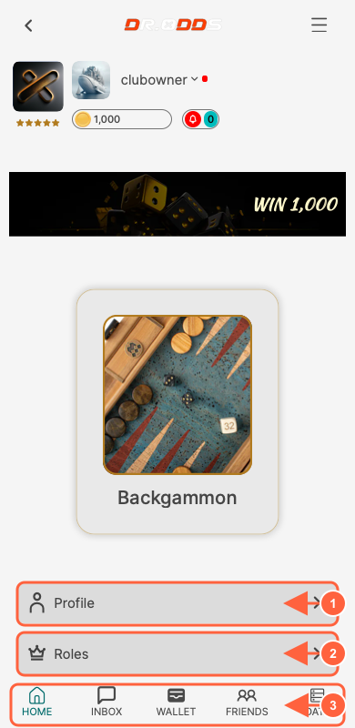
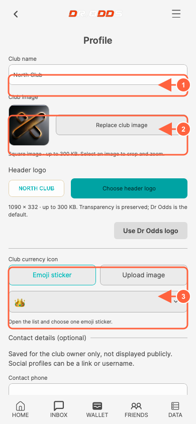
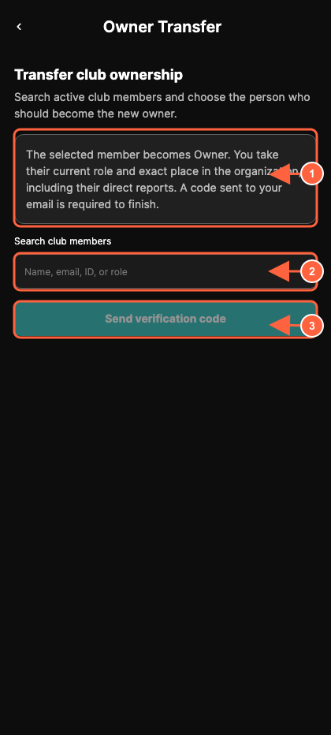

# Club owner guide

A club owner manages one club. Club-owner tools affect that club; they are different from super-admin tools that manage the whole platform.

## Open club management

Select your club card from the lobby. The club-management area is on the club’s own page and may continue below the visible screen. The options shown depend on your permissions and which features are available for that club.

1. **Profile** opens the club profile and appearance details.  
2. **Roles** opens role ordering and names.  
3. The bottom navigation remains available while you move between club pages.

## Club profile

Open **Profile** from the club management menu. You may see:

- **Club name:** The name shown on club cards and lists. If another club already uses it, choose a unique name.
- **Club image:** Choose and crop a square image so it fits the club card.
- **Header logo:** Replace or remove a custom header mark. You may also be able to return to the Dr.odds logo.
- **Club currency icon:** Choose a symbol or upload an allowed image. Make it easy for members to tell this currency apart from platform diamonds.
- **Exchange ratio:** If your club needs to take part in a cross-club tournament or arrangement, read the on-page explanation and enter the agreed rate. Leave it blank if you do not need that option yet.
- **Contact details:** These may be optional. Read the note by the field to see whether it is visible to other people.

1. Club name field.  
2. Club image.  
3. Currency symbol and related options further down the page.

Review the whole form before saving. Then reopen the club lobby to check the name, image and symbol.

## Members and organization

Open **Organization** to browse club members, roles and reporting order. Search or filter by role to find someone. Expanding a member card may show more information and actions you are allowed to take.

- Review membership status to distinguish active, invited and suspended accounts.
- Join requests have their own view. If auto-approval is enabled, new requests may be accepted without a manual review.
- Change role order under **Roles**; Organization shows how a member relates to the roles above them.
- Changing a member’s role affects their access to this club. Check the new role before saving.

See [Club roles and access](club-team.md) for details.

## Invite to Club

The invitation page can show a public ID, referral code, membership link and a share option. If adding by email is available, enter the member’s email and choose the right role.

1. Confirm the selected club is the one you intend to invite someone to.
2. Choose a role that matches the person’s actual responsibilities. Do not assign the owner role for routine tasks.
3. Share the invitation link or code only with the intended recipient.
4. Follow the request from the member list.

## Other owner tools

Depending on the club, you may also see:

- **Roles and Permissions:** Create or reorder team roles and select which menus each role or member can use.
- **Exchange:** Choose whether members may transfer club currency only within their organization branch or more broadly.
- **Shop:** Review products and options available to the account or club. Check which balance will be used and the displayed price before buying; see [Wallet and shop](shop-wallet-data.md).
- **Diamond Transfer:** Transfer platform diamonds from the owner to an eligible member when this option is available; carefully verify the recipient and amount.
- **Games:** Enable purchased games, set a club display name, choose available formats and review game limits. Game license prices are handled in the shop; the club’s running costs are shown separately.
- **Rake:** Review the available rake or rake-back settings for eligible games.
- **Slot Machine:** Set whether play is enabled, which wagers are allowed, the payout multipliers and the prize fund. See [Game guide](games.md) and the [annotated owner settings](../media/slot-settings-fa.png).
- **Pop-Up Notification, Club Story and Unions:** Share information with club members or manage a club story and relationships with other clubs.
- **Appearance:** Update visual details available for the club.
- **Background Music:** Choose music for the lobby and game screens, preview it, then save. Leaving a destination empty may keep its previous track. Each track can be up to 5 MB in MP3, M4A, WAV, Ogg or FLAC format when accepted by the page.
- **Settings:** Review remaining club options and the owner-transfer route when it is available.

Some tools appear only when their feature is available for the club or your role. If an item is missing, check the club and ask an owner before assuming the page is broken.

## Transfer club ownership

Transferring ownership is a significant change. Choose a member of the same club and read the explanation first. The new owner may receive your role and place in the club organization, and your own access may change. A verification code is required to finish.

1. Read what the transfer changes.  
2. Search for the intended member and verify their name.  
3. Request the verification code only when you intend to proceed. Never share the code. Close the page if you are not transferring ownership.

