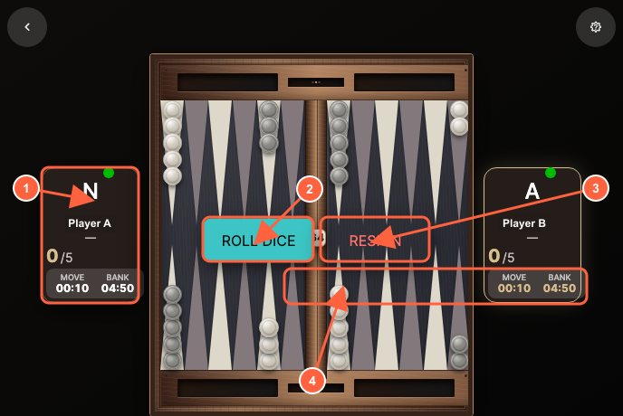
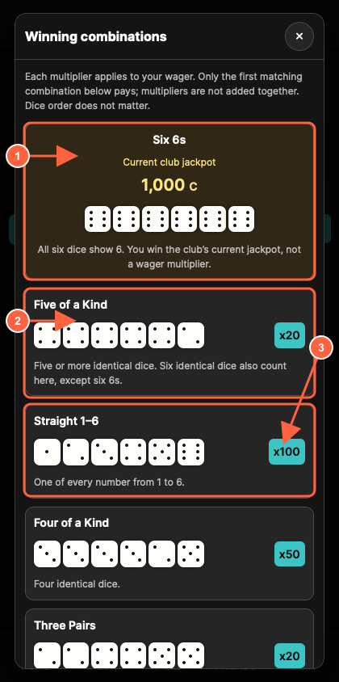

# Game guide

## Before you start

Open games from a club’s lobby. If the club offers more than one format, choose the one you want:

- **Single:** One standalone game.
- **Sit-and-Go:** Register for a competition that starts once the required places or conditions are met.
- **Tournament:** Browse events, registration, schedules and results.

Review the entry amount, club currency, start time and any other conditions shown for that game. Creating a table or entering a format may require a club permission. If you do not see a create button, ask the club owner whether your role can create games.

## Backgammon

### Join a table

1. Open Backgammon from the club’s game area.
2. Join an available table, or create one if your role is allowed to do so.
3. Review the match length, speed, entry conditions and amount shown on the page.
4. Complete any approval step for a private table.
5. Wait for the opponent and board to be ready.

### Read the game screen

1. A player panel shows the active-turn marker and that player’s clocks. The marker moves to show whose turn it is.  
2. Press **Roll Dice** on your turn. Legal destinations are highlighted after the roll.  
3. **Resign** sends a request to give up the game. The opponent may accept or reject it.  
4. Check each player’s move clock and time bank in the side panels; they track different kinds of remaining time.

### Move a checker

- Select a checker to highlight legal destinations, then tap or click a highlighted point.
- On a touch screen or with a mouse, you can also drag the checker and drop it on a highlighted point.
- **Confirm** commits the selected moves. **Undo** is only available when the active game rules allow a selected move to be taken back.
- Some forced moves may happen automatically. Bearing off the final checker may still require your choice.
- A number near the board may be a **pip count**: the total distance the checkers have left to travel, not how many checkers remain.

### Optional controls

- **Auto Dice** rolls the dice automatically on your turn, if shown.
- **Double** appears only when it is allowed. Read the prompt and confirm your offer; your opponent can accept or decline.
- **Resign** sends an offer to your opponent after you confirm.
- The top menu opens available view settings. A spectator icon may open the spectator list when the feature is enabled.
- Voice, short messages and stickers are not present in every game. They appear only when the relevant feature is available to your account and club. Allow microphone access only when you need it and trust the page.

At the end, review the result and any prize details. Confirming the result takes you back to the lobby or shows your other active games. **View analysis** is available only when analysis has been made available for that account and match.

## Roulette

Open Roulette from the club’s game area. Review the table information and allowed minimum or maximum before placing a wager. Choose the relevant option, review the amount and selection summary, and confirm only when it is correct. The result and settlement for that round appear when the round ends.

The live-table layout and available wager options may vary between clubs and releases. A submitted wager might be locked until the round finishes, so check the amount and selections before confirming.

## Slot Machine

Slot Machine requires active membership in the club, the feature to be available for that club and the owner to enable play. A direct link by itself does not grant access.

1. Open the Slot Machine banner in the club lobby. It may display the current jackpot.
2. Choose a wager. If the owner has set a fixed wager, the plus and minus controls are disabled.
3. Press **Roll Dice** and review the result.
4. Open **Winning combinations** to read how combinations and multipliers work.
5. **History** shows your recent games; **Winners** shows recent club winners. A shared **Pool Prize**, if enabled, is shown separately.

1. Current club jackpot.  
2. Example winning combination.  
3. The multiplier for that combination.

**Only the first matching combination pays; multipliers are not added together.** Dice order does not matter. Results are random: a previous win or a listed multiplier does not predict the next roll.

If the owner has paused play or the prize fund is not available, the game may not start. Once the owner re-enables it, reopen the page and review the allowed wager again.

