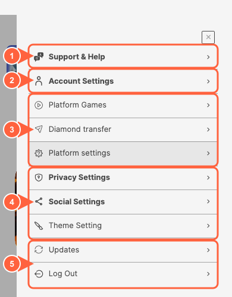

# Platform settings and feature controls

## Club creation

Open **Platform settings** and find the club-creation section. Turn **Show Create club button** on or off. Disabling it can hide the button and block new club creation requests. Before saving, decide whether the change should apply to every user.

## Menu visibility

In **Menu visibility**, review the Club owner menu and Hamburger menu separately. The owner list may include Profile, Roles, Permissions, Organization, Invite to Club, Exchange, Diamond transfer, Games, Slot Machine, Rake, Unions, Ban Player, Pop-Up Notification, Background Music, Club Story, Appearance and Settings.

The hamburger list contains general account options such as Language, Sounds and Vibrations, Notifications, Privacy, Theme, Profile, Account settings, Support & Help and Log Out. Turn menu items on or off, then save the changes together.

1. General help and support.  
2. Account settings.  
3. Some shortcuts appear only for admin roles.  
4. Privacy and appearance settings.  
5. Updates and Log Out.

After changing several options, save once and review the view for the intended role. Hiding a menu removes it from the target user’s view. Do not change live user access just to experiment.

## Feature controls

**Feature controls** lets you enable or disable a feature for everyone, then add a club or account exception. Account registration and game streaming may be controlled here.

The most specific exception takes priority:

1. An account exception applies to that account.
2. A club exception applies to that club when there is no account exception.
3. The **Everyone** setting is the default when neither exception exists.

For example, a feature can be off for everyone but enabled for one club, if all other eligibility requirements are met. Registration is controlled for everyone because someone who has not joined yet cannot be matched to a club.

Changes apply immediately. Check the selected target and access state before applying, and verify them after. Do not confuse one account or club with another.

## A missing menu is not always a broken page

A menu can be hidden by platform visibility settings, unavailable to your role, or dependent on a club feature that has not been enabled. Check the menu setting, feature availability and current role first. If you still expect to see the item, contact support.

