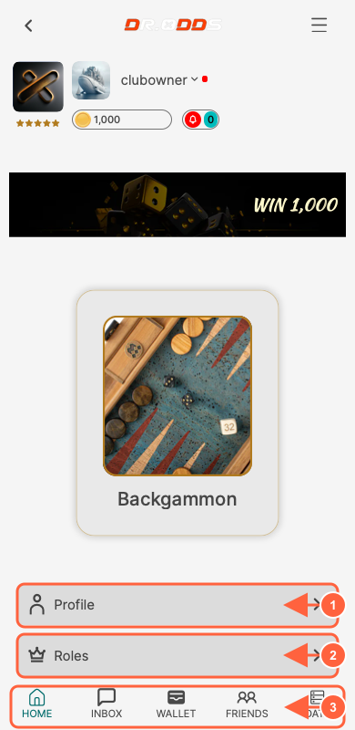

# Player guide

## 1. Find and open a club

From the Home or Lobby page, find the club card you want. Swipe or drag through the club row if you have several clubs. **Search clubs** helps you find a club; **Create club** is available only to accounts allowed to create one.

Select a club card to open that club’s lobby. The card may show the club name, picture, rating and public ID. Before joining a game, confirm that you opened the intended club: the currency and game rules may differ from one club to another.

1. Club profile details.  
2. **Roles** shows the order of club roles; this menu is usually available to people with management access.  
3. The bottom navigation. This example shows Home, Inbox, Wallet, Friends and Data. In a club, **Wallet** can open that club’s exchange or wallet area.

## 2. Bottom navigation and the hamburger menu

The bottom bar is a set of shortcuts. It can change between the platform lobby and a club lobby:

- **Home / Lobby:** Return to the club list or the current club’s home.
- **Inbox:** Open conversations and messages available to you.
- **Wallet / Exchange:** See your inventory or balance history, or the current club’s transfer area. The destination depends on where you are.
- **Shop:** Browse products available to your account.
- **Friends:** Review your friend list and requests, when this tab is shown.
- **Data:** Review game history and statistics.

Use the three-line button at the top for account-wide settings. See [Getting started](start-here.md) for the main-menu options.

## 3. Profile and friends

Select your avatar or profile area to open your player profile. Depending on the page, it may show your picture, display name, badges and statistics. Only share details you are comfortable showing under your privacy settings.

Use **Friends** to review connections and requests. Some pages may let you choose a friend to invite to a game. An empty list does not always mean something is wrong; you might not have a request yet, or a filter may be active.

## 4. Inbox

Open a conversation, enter a message in the box at the bottom and review who will receive it before sending. Club conversations are available only when your account has permission to open them. If a club inbox is missing from your menu, ask the club owner to check your access.

## 5. Invitations and club membership

An invitation may be shared as a link or code. Send it only to the person you intend to invite: opening it may take them directly to that club’s membership page. Some clubs review join requests before activating membership. Until your membership is active, some club games and menus may not be available.

If an invitation was declined or has expired, ask the club owner or the person who invited you for a fresh invitation. Do not rely on an old link from someone you do not know.

## 6. Club pop-up messages

A pop-up shown when you enter a club may be a message from its owner. Read it, then continue to the lobby or game. A club message is different from an operating-system notification; device notifications are managed in the main menu.

## 7. When an option is missing

Your role is set separately for each club. You might be a player in one club and a manager in another. The owner can also choose which club menus each role may open. See [Club roles and access](club-team.md), or ask the owner of that club. Players cannot grant themselves a new role or permission.

