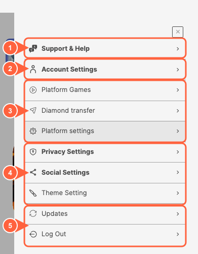

# Getting started and the main menu

## Sign in and choose a language

1. Open the Dr.odds sign-in page and use an available sign-in method for your account.
2. If the sign-in flow asks you to confirm your account with a code, enter it only on your own sign-in screen. Never send that code to another person.
3. After you sign in, you’ll land in the lobby. You may see club cards, featured games or other options that are currently available.
4. To change the display language, open the hamburger menu and choose **Language**. English and Persian are available. The page direction follows the language.

Open the main menu with the three-line button at the top of the screen. Use a page’s own **Back** button to leave it; if you have unsaved changes, the page may give you a chance to review them.

1. **Support & Help** opens available help and support options.  
2. **Account Settings** contains account-related settings.  
3. Platform and admin shortcuts appear only for accounts with the right role.  
4. Privacy, social and appearance settings.  
5. Updates and Log Out.

## Main-menu options

- **Language:** Choose the language used across the app.
- **Sounds and Vibrations:** Adjust sound and vibration feedback for your device.
- **Notifications:** Review the notification options available to your account.
- **Privacy Settings:** Review who can see your profile information.
- **Theme Setting:** Choose a light or dark appearance.
- **Profile Setting:** Review and edit display details for your profile.
- **Account settings:** Account security options, such as changing a password or deleting an account, may be available here. Read any final confirmation carefully.
- **Support & Help:** Open the help center or support requests, if those are enabled for you.
- **Game fairness & security:** View the public random-game identifier and related information.
- **Log Out:** End the current sign-in session. Log out when using a shared device.

Some items open a small sub-menu. For example, expand **Account settings** or **Support & Help** to see their available actions. If you see **Club Settings**, make sure you are in the right club; it is an owner option.

## The platform lobby and a club lobby

- The **platform lobby** helps you find clubs, open a club, create one if allowed, and reach account-level shortcuts.
- A **club lobby** belongs to one club. It contains that club’s games, member activity and club-specific menus.
- The **main menu** contains general account settings and role-based shortcuts. Club-management options may appear on the club’s own page.

If you use more than one account on a device, check the active account and role before doing anything important. A game, invitation, message or transfer is recorded for the account that is currently active.

