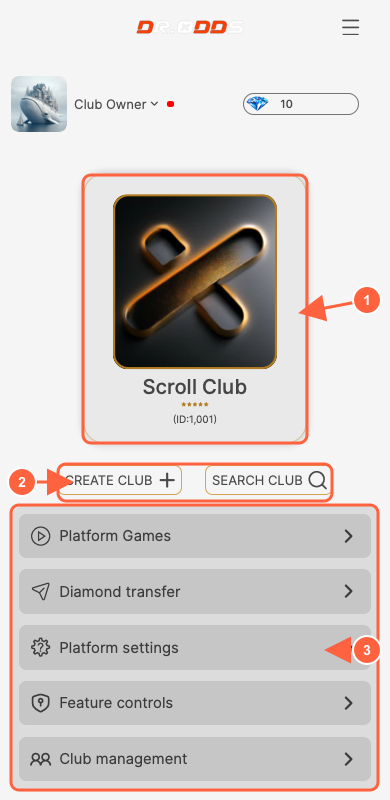

# Super admin guide

Super admins can manage parts of the whole platform. Changes in these pages can affect club owners, players, products or game charges. Before saving, review the page, the target account or club, and every value you selected.

## Find the admin pages

Open **Super admin** from the lobby or the platform shortcuts. The Super admin page contains the main sections and cards.

1. The selected club card provides context for club-level actions.  
2. Search or create a club; creating clubs can be disabled by a platform setting.  
3. Platform shortcuts include Platform Games, Diamond transfer, Platform settings, Feature controls and Club management.

The admin navigation includes **Super admin, Platform games, Shop, Diamond packages, Owner diamonds and Diamond transfer**. The lobby may also provide shortcuts for **Platform settings, Feature controls, Club management and Player management**.

## Platform games

**Platform games** lists installed games and their current availability. Open a game to review its settings:

- **System name:** The game’s system label. Use the name visible to users when writing help for players.
- **Game name shown in clubs:** The name used in club cards and lists.
- **Game card image:** Replace, crop and save the image shown to users.
- **Game and format availability:** A game or one of its formats can be enabled or disabled.
- **Game running costs:** Fees may be separate for Single, Sit-and-Go and Tournament play, and may be charged overall or per game.

The game’s purchase or sale price is managed in **Shop**. Do not confuse a license price with its running cost. Before disabling a game, read the page and consider the effect on clubs that use it.

## Platform shop

In **Shop**, open a product or category to review it. Depending on the product, you may be able to change its name, description, group, diamond price, image, stock and sale status.

- If stock is limited, review the remaining quantity; zero may mean the item is sold out.
- Check the buyer-facing price and description before turning an item on sale.
- Access or recurring products may have eligibility and duration rules. Read the product description carefully.
- After saving, review how the product appears in the shop.

## Diamond packages

**Diamond packages** are the packages available to club owners. Set the number of diamonds and the USD price. Only active packages are offered to owners. Check the package amount and price separately before enabling it.

## Owner diamonds

**Owner diamonds** shows owner balances and purchase requests. Confirm a request only after its payment reference has been matched and verified according to your organization’s process. If the payment cannot be verified, do not confirm the request. Avoid using live account details in public help images.

## Diamond transfer

In **Diamond transfer**, find the account using the identifier accepted by the page, then choose whether to add or deduct diamonds and enter the amount. Before saving:

1. Confirm the selected account is the intended one.
2. Read the operation type: add or deduct.
3. Review the amount; this is an account adjustment and does not change the super admin’s own diamond balance.
4. After saving, review the result in the filtered financial report.

The report can be filtered by date, account, category and transaction type. Categories may include admin adjustments, game runs and refunds, game licenses, diamond purchases, shop purchases and team transfers. Check the filters before exporting.

## Home-page banners

If **Banners** is available in your version, use it to arrange the carousel at the bottom of the home page. For each banner, set its image, order, visibility and click destination. Add both English and Persian image descriptions so the image is described in either language.

1. Select **Add banner** to create a row, or **Remove banner** on a row you want to delete.
2. Choose and crop the image in the preview frame. The crop is **1472 × 680**. Source JPG, PNG or WebP files can be up to 12 MB; the saved, compressed image must be under 600 KB.
3. Choose what a click does: nothing, open a menu, open a club, join a club, open a tournament or go to tournament registration. Enter the correct club or tournament ID when the selected destination asks for one.
4. Review the order and visibility of every banner, then select **Save**. The page saves its changes together.

A tournament banner does not join or register a player by itself. The player still needs to meet the regular membership, capacity, password and entry-fee requirements, and must complete the normal join or registration steps. After saving, open the home page and check the destination.

## Platform settings and feature controls

**Platform settings** controls options such as club creation and menu visibility. **Feature controls** can enable or pause features such as registration and streaming, with exceptions for a club or account. These changes can affect other people. Check the target and scope before applying a change. See [Platform settings and feature controls](platform-settings.md) for the step-by-step guide.

## Club management

Search for a club by name, ID or address, or filter by its status. Open a club to review its summary and use the **Players, Live games and Finance** tabs.

- **Players:** Search members and filter by active, invited or suspended status.
- **Live games:** Filter by game and review the available live sessions.
- **Finance:** Choose dates, transaction type, report subject and direction. Apply the filters, read totals and transaction count, then export the matching result to Excel if needed.

## Player management

In **Player management**, search the platform’s players by name, username, email or player ID. Each row also shows the number of associated clubs. Open a player to review account details, club memberships, verified club-currency balances and actual game activity.

Use these details to handle that player’s request. Match the account and club before taking action. Never include a real name, email, account ID or balance in a public screenshot, message or help guide.

