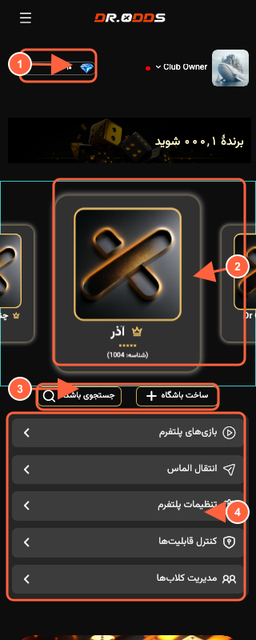
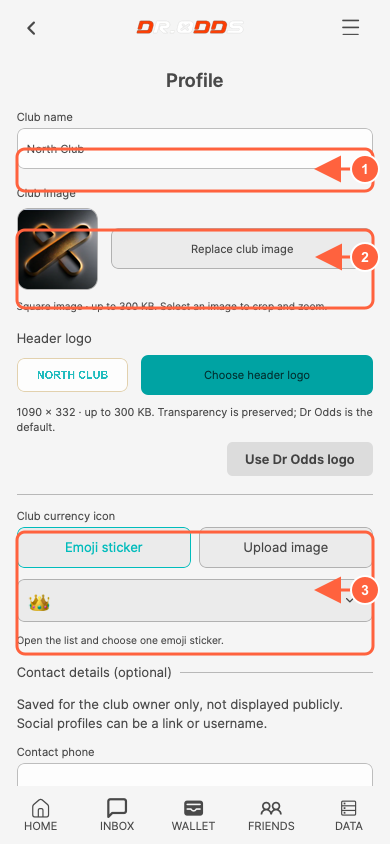
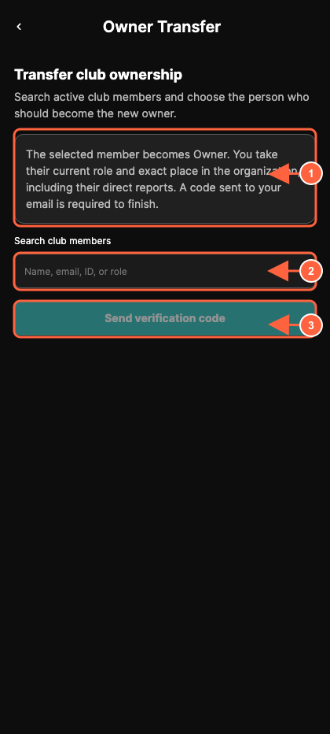

# راهنمای صاحب کلاب

صاحب کلاب، تنظیمات و اعضای همان کلاب را مدیریت می‌کند. اختیارات سوپرادمین با صاحب کلاب فرق دارد؛ منوهای مدیریتی کلاب روی کلاب فعال اعمال می‌شوند، نه روی تمام Dr.odds.

## ورود به بخش مدیریت کلاب

در لابی، کارت کلاب خودتان را باز کنید. بخش مدیریت در صفحهٔ کلاب نمایش داده می‌شود و ممکن است تا پایین صفحه ادامه داشته باشد. فهرست گزینه‌ها به دسترسی‌ها و امکانات فعال آن کلاب بستگی دارد.

۱. بخش حساب/نقش فعال.  
۲. کارت کلاب انتخاب‌شده؛ انتخاب کارت، لابی همان کلاب را باز می‌کند.  
۳. ساخت کلاب یا جست‌وجوی کلاب، اگر برای شما فعال باشد.  
۴. میان‌برهای مدیریتی پلتفرم؛ این‌ها دسترسی سوپرادمین‌اند و برای همهٔ صاحبان کلاب نمایش داده نمی‌شوند.

## پروفایل کلاب

از منوی مدیریتی کلاب، **پروفایل** را باز کنید. در فرم ممکن است این موارد را ببینید:

- **نام کلاب:** نامی که در کارت‌ها و فهرست‌ها دیده می‌شود. اگر نام قبلاً استفاده شده باشد، نام یکتای دیگری وارد کنید.
- **تصویر کلاب:** تصویر مربعی را انتخاب و در قاب برش دهید تا در کارت کلاب خوانا باشد.
- **لوگوی سربرگ:** نشان اختصاصی سربرگ را جایگزین یا حذف کنید؛ اگر گزینه‌اش وجود دارد، می‌توانید دوباره نشان Dr.odds را انتخاب کنید.
- **نماد ارز کلاب:** یک نماد انتخاب کنید یا تصویر مجاز را بارگذاری کنید. قبل از ذخیره، مطمئن شوید اعضا می‌توانند ارز شما را از الماس پلتفرم تشخیص دهند.
- **نسبت ارز به الماس:** در صورت نیاز به مسابقه یا همکاری بین کلاب‌ها، توضیح این بخش را بخوانید و مقدار توافق‌شده را وارد کنید. اگر فعلاً به این قابلیت نیاز ندارید، می‌تواند خالی بماند.
- اطلاعات تماس، اگر نمایش داده شوند، طبق توضیح همان فیلد ذخیره می‌شوند و ممکن است عمومی نباشند.

۱. نام نمایشی کلاب.  
۲. تصویر کلاب.  
۳. نماد ارز. بخش‌های پایین‌تر صفحه ممکن است فیلدهای اختیاری دیگری داشته باشند.

پس از ویرایش، همهٔ فیلدها را مرور و ذخیره کنید. پس از ذخیره، لابی را دوباره باز کنید تا تصویر و نماد به‌روز را ببینید.

## اعضا و سازمان

از **ساختار اعضا / Organization** می‌توانید اعضا، نقش و جایگاهشان در سازمان را مرور کنید. از جست‌وجو و فیلتر نقش استفاده کنید تا عضو را پیدا کنید. بازکردن کارت یک عضو ممکن است جزئیات و کارهای مجاز برای او را نشان دهد.

- فهرست اعضا با وضعیت عضویت کمک می‌کند فعال، دعوت‌شده یا معلق را از هم تشخیص دهید.
- درخواست‌های عضویت را جداگانه بررسی کنید؛ اگر تأیید خودکار فعال است، عضو ممکن است بدون بررسی دستی پذیرفته شود.
- ترتیب نقش‌ها را در صفحهٔ «نقش‌ها» تنظیم کنید؛ ساختار اعضا رابطهٔ هر عضو با جایگاه بالاتر را نشان می‌دهد.
- تغییر نقش یک نفر روی دسترسی‌های همان کلاب اثر می‌گذارد. پیش از تغییر، مطمئن شوید نقش مقصد را درست انتخاب کرده‌اید.

جزئیات کامل در [نقش‌ها و دسترسی‌های تیم](club-team.md) آمده است.

## دعوت به کلاب

از **دعوت به کلاب** می‌توانید شناسه یا کد معرفی، پیوند عضویت و گزینهٔ اشتراک‌گذاری دعوت را ببینید. در صورت فعال‌بودن گزینهٔ افزودن با ایمیل، ایمیل عضو و نقش مناسب را وارد کنید.

1. مطمئن شوید کلاب انتخاب‌شده همان کلابی است که می‌خواهید دعوتش را بفرستید.
2. نقش را بر اساس مسئولیت واقعی شخص انتخاب کنید؛ نقش مالک را برای کار روزمره به کسی ندهید.
3. پیوند یا کد عضویت را فقط برای دریافت‌کنندهٔ موردنظر بفرستید.
4. وضعیت درخواست را از صفحهٔ اعضا پیگیری کنید.

## تنظیمات پرتکرار دیگر

منوی مدیریتی ممکن است این موارد را داشته باشد:

- **نقش‌ها و دسترسی‌ها:** تعریف نقش‌های تیم و تعیین منوهای مجاز برای هر نقش.
- **تبادل:** کنترل اینکه اعضا با چه کسانی می‌توانند ارز کلاب را انتقال دهند.
- **شاپ:** کالاها و گزینه‌های قابل تهیه برای حساب یا کلاب را ببینید؛ پیش از خرید، نوع موجودی و قیمت همان صفحه را بررسی کنید. توضیح بیشتر در [کیف پول و شاپ](shop-wallet-data.md) است.
- **انتقال الماس:** اگر منو در دسترس است، از موجودی الماس صاحب کلاب به عضو مجاز انتقال دهید. نام دریافت‌کننده و مبلغ را قبل از تأیید دوباره بررسی کنید.
- **بازی‌ها:** روشن‌کردن بازی‌های خریداری‌شده، تغییر نام نمایشی، انتخاب حالت‌ها و بررسی محدودیت‌های هر بازی.
- **Rake:** تنظیم سهم یا برگشت مربوط به بازی، اگر بازی و کلاب از آن پشتیبانی کنند.
- **اسلات ماشین:** تنظیم بازی، مبلغ مجاز، ضرایب و صندوق جایزه؛ راهنمای نمونه در [بخش بازی‌ها](games.md) و تصویر [تنظیمات اسلات](../media/slot-settings-fa.png) است.
- **اعلان پاپ‌آپ، داستان کلاب و اتحادیه‌ها:** تعامل و اطلاع‌رسانی مربوط به کلاب یا همکاری با کلاب‌های دیگر.
- **ظاهر:** تصویر، رنگ یا اجزای نمایشی قابل انتخاب برای کلاب.
- **موسیقی پس‌زمینه:** برای لابی و منوی بازی موسیقی انتخاب کنید و پیش از ذخیره پیش‌نمایش بگیرید. خالی‌گذاشتن یک بخش ممکن است موسیقی قبلی را نگه دارد.
- **تنظیمات:** گزینه‌های دیگر کلاب را مرور کنید. اگر «انتقال مالکیت» اینجا نمایش داده می‌شود، پیش از شروع اثر آن بر دسترسی و جایگاه شما را بخوانید؛ راهنمای آن پایین همین صفحه است.

اگر گزینه‌ای در منوی شما نیست، ممکن است قابلیت تهیه نشده باشد یا نقش شما اجازهٔ آن را ندهد. برای تصمیم‌های مالی و تغییرات گسترده، مبلغ، دامنهٔ اثر و کلاب فعال را پیش از ذخیره دوباره بررسی کنید.

## انتقال مالکیت

«انتقال مالکیت» یک تغییر مهم است. فقط یک عضو قابل انتخاب در همان کلاب را انتخاب کنید و متن توضیح صفحه را بخوانید. مالک جدید ممکن است نقش و جایگاه سازمانی شما را بگیرد و دسترسی مدیریتی شما تغییر کند. برای نهایی‌کردن، کدی که برای تأیید فرستاده می‌شود لازم است.

۱. پیامد انتقال را بخوانید.  
۲. عضو مقصد را جست‌وجو و نامش را دوباره بررسی کنید.  
۳. کد تأیید فقط برای تکمیل درخواست است؛ آن را به کسی ندهید. اگر قصد تغییر مالک را ندارید، کدی درخواست نکنید و صفحه را ببندید.

