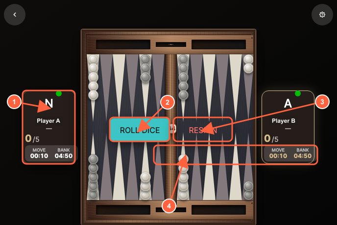
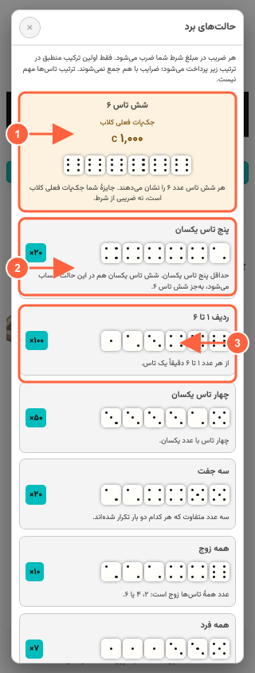

# راهنمای بازی‌ها

## پیش از شروع

بازی‌ها از لابی کلاب باز می‌شوند. اگر چند شیوهٔ بازی دیده می‌شود، گزینهٔ مناسب را انتخاب کنید:

- **تک‌بازی / Single:** برای یک بازی جداگانه.
- **سیت‌اندگو / Sit-and-Go:** ثبت‌نام برای رقابتی که با تکمیل ظرفیت یا آماده‌شدن شرایط شروع می‌شود.
- **تورنمنت / Tournament:** فهرست مسابقه‌ها، ثبت‌نام، برنامه و نتیجه‌ها.

برای هر بازی، مبلغ ورود، ارز کلاب، زمان یا شرایط شروع ممکن است نمایش داده شود. آن‌ها را پیش از پیوستن بخوانید. ساخت میز یا ورود به بعضی حالت‌ها به مجوز کلاب نیاز دارد. دکمهٔ ساخت میز را فقط وقتی می‌بینید که برای نقش شما فعال باشد.

## تخته‌نرد

### پیوستن به میز

1. از صفحهٔ بازی کلاب، نوع یا میز در دسترس را انتخاب کنید.
2. اگر لازم است، میز جدید بسازید یا به میز آماده ملحق شوید.
3. مبلغ ورود، طول مسابقه، سرعت بازی و شرایط نمایش‌داده‌شده را مرور کنید.
4. اگر میز خصوصی یا نیازمند تأیید است، درخواست ورود را تکمیل کنید.
5. بعد از آماده‌شدن حریف و تخته، بازی شروع می‌شود.

### خواندن صفحهٔ بازی

۱. پنل بازیکن، نشانهٔ نوبت و زمان‌ها را نشان می‌دهد. حلقهٔ فعال کنار آواتار مشخص می‌کند نوبت چه کسی است.  
۲. در نوبت خود «تاس بریزید / Roll Dice» را بزنید. مقصدهای مجاز پس از ریختن تاس مشخص می‌شوند.  
۳. «واگذاری / Resign» درخواست واگذاری دست است؛ ممکن است بازیکن مقابل آن را بپذیرد یا رد کند.  
۴. زمان حرکت و زمان ذخیرهٔ بازیکن‌ها را از پنل‌های کناری دنبال کنید. این دو زمان معنا و محل متفاوت دارند.

### حرکت مهره

- مهره را بزنید تا خانه‌های مجاز روشن شوند؛ مهره را با کلیک یا لمس به خانهٔ روشن ببرید.
- در دستگاه لمسی یا با ماوس می‌توانید مهره را بکشید و روی مقصد روشن رها کنید.
- دکمهٔ تأیید، حرکت‌های انتخاب‌شده را نهایی می‌کند. دکمهٔ برگشت فقط زمانی نمایش داده می‌شود که قانون بازی امکان برگرداندن حرکت انتخابی را بدهد.
- بعضی حرکت‌های اجباری به‌صورت خودکار انجام می‌شوند؛ خارج‌کردن آخرین مهره همچنان ممکن است به انتخاب بازیکن نیاز داشته باشد.
- عدد کنار تخته ممکن است «پیپ‌کانت» باشد: مجموع فاصلهٔ مهره‌ها تا خروج، نه تعداد مهره‌های مانده.

### کنترل‌های اختیاری

- **تاس خودکار:** اگر نمایش داده شد، تاس را در نوبت شما خودکار می‌ریزد.
- **دوبرابر / Double:** فقط در موقعیت مجاز ظاهر می‌شود. پیشنهاد را بخوانید و بعد از پیام تأیید تصمیم بگیرید؛ حریف می‌تواند بپذیرد یا رد کند.
- **واگذاری:** با تأیید شما درخواست را برای حریف می‌فرستد.
- **نمای بازی:** منوی بالای تخته تنظیمات نمای قابل استفاده را باز می‌کند. آیکون بینندگان، در صورت فعال‌بودن، فهرست تماشاگران را باز می‌کند.
- **صدا، پیام کوتاه یا استیکر:** این‌ها قابلیت‌های همیشگی همهٔ میزها نیستند؛ اگر در حساب، کلاب و بازی شما فعال باشند نمایش داده می‌شوند. دسترسی میکروفون را فقط وقتی لازم است و برای صفحهٔ مورداعتماد مجاز کنید.

پس از نتیجه، پیام برد/باخت و نتیجهٔ همان دست را مرور کنید. تأیید شما را به لابی برمی‌گرداند یا ادامهٔ بازی‌های فعال را نشان می‌دهد. «مشاهدهٔ تحلیل» فقط وقتی قابل استفاده است که تحلیل برای حساب و آن مسابقه در دسترس باشد.

## رولت

از بخش بازی کلاب، رولت را انتخاب کنید. پیش از قرار دادن شرط، توضیح میز و حداقل/حداکثر مجاز را بخوانید. انتخاب شرط را روی گزینهٔ دلخواه انجام دهید، مبلغ را بازبینی کنید و فقط بعد از دیدن خلاصهٔ انتخاب آن را تأیید کنید. پس از پایان دور، نتیجه و پرداختی همان دور را در صفحه ببینید.

نمایش میز زنده و گزینه‌های شرط می‌تواند بسته به کلاب یا نسخه متفاوت باشد. شرطی که ارسال شده ممکن است تا پایان دور در دسترس نباشد؛ پیش از تأیید، مبلغ و خانه‌های انتخابی را دوباره بررسی کنید.

## اسلات ماشین

دسترسی به اسلات به عضویت فعال در کلاب، فعال‌بودن این بازی برای همان کلاب و روشن‌بودن بازی توسط صاحب کلاب بستگی دارد. صرف داشتن پیوند، دسترسی ایجاد نمی‌کند.

۱. از بنر اسلات در لابی کلاب وارد شوید. مبلغ جک‌پات فعلی ممکن است روی بنر نمایش داده شود.
۲. مبلغ بازی را انتخاب کنید؛ اگر کلاب مبلغ ثابت گذاشته باشد، کلیدهای افزایش/کاهش غیرفعال‌اند.
۳. «تاس بریزید» را بزنید و نتیجه را ببینید.
۴. از دکمهٔ «حالت‌های برد / Winning combinations» ترکیب‌ها را مرور کنید.
۵. «History» بازی‌های اخیر خودتان را نشان می‌دهد؛ «Winners» برنده‌های اخیر کلاب را. جایزهٔ استخر یا Pool Prize از موجودی جایزهٔ کلاب می‌آید و جداگانه نمایش داده می‌شود.

در این مثال، شمارهٔ ۱ جک‌پات فعلی کلاب است؛ شمارهٔ ۲ یک ترکیب برنده را نشان می‌دهد؛ شمارهٔ ۳ ضریب همان ترکیب را. **فقط اولین ترکیب منطبق پرداخت می‌شود و ضرایب با هم جمع نمی‌شوند.** ترتیب تاس‌ها مهم نیست. نتیجه‌ها شانسی‌اند و دیدن یک ضریب یا برد قبلی، نتیجهٔ دور بعد را تضمین نمی‌کند.

اگر صاحب کلاب بازی را متوقف کرده یا صندوق جایزه نیاز به تأمین داشته باشد، شروع بازی ممکن نیست. پس از فعال‌شدن دوبارهٔ بازی، صفحه را تازه‌سازی کنید و مبلغ کلاب را دوباره بخوانید.

