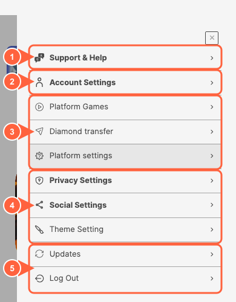

# تنظیمات و قابلیت‌های پلتفرم

## ساخت کلاب

در **تنظیمات پلتفرم**، بخش ساخت کلاب را باز کنید. گزینهٔ نمایش دکمهٔ «ساخت کلاب» را روشن یا خاموش کنید. خاموش‌کردن آن ممکن است هم دکمه را از لابی بردارد و هم درخواست‌های تازهٔ ساخت را متوقف کند. پیش از ذخیره، تصمیم بگیرید آیا این محدودیت باید برای همهٔ کاربران اعمال شود.

## نمایش منوها

در **نمایش منوها**، بخش صاحب کلاب و منوی همبرگری را جداگانه مرور کنید. گزینه‌های ممکن برای صاحب کلاب شامل پروفایل، نقش‌ها، دسترسی‌ها، ساختار اعضا، دعوت، تبادل، انتقال الماس، بازی‌ها، اسلات، Rake، اتحادیه، مسدودکردن بازیکن، اعلان پاپ‌آپی، موسیقی، داستان کلاب، ظاهر و تنظیمات است.

بخش منوی همبرگری، گزینه‌های عمومی حساب را در بر می‌گیرد؛ مانند زبان، صدا، اعلان، حریم خصوصی، پوسته، پروفایل، حساب، راهنما و خروج. می‌توانید هر گزینه را مطابق تنظیم پلتفرم روشن یا خاموش کنید.

۱. پشتیبانی و راهنمای عمومی.  
۲. تنظیمات حساب.  
۳. بعضی میان‌برها فقط برای نقش مدیریتی‌اند.  
۴. تنظیمات حریم خصوصی و ظاهر.  
۵. به‌روزرسانی‌ها و خروج از حساب.

پس از تغییر چند گزینه، همه را یکجا ذخیره کنید. سپس نمایی را که برای نقش هدف در نظر گرفته‌اید مرور کنید. خاموش‌کردن گزینه، قابلیت را برای کاربر هدف پنهان می‌کند؛ آن را برای آزمایش روی یک حساب واقعی بدون برنامه‌ریزی تغییر ندهید.

## کنترل قابلیت‌ها

در **کنترل قابلیت‌ها** می‌توانید دسترسی عمومی به قابلیت‌هایی مانند ثبت‌نام حساب یا استریم بازی را روشن یا خاموش کنید. برخی قابلیت‌ها برای همه فعال‌اند و می‌توان برای یک کلاب یا حساب استثنا تعریف کرد.

ترتیب اثر استثناها مهم است:

1. استثنای یک حساب از همه مشخص‌تر است.
2. استثنای یک کلاب بعد از آن اعمال می‌شود.
3. گزینهٔ «همه» حالت پیش‌فرض می‌ماند، وقتی استثنای نزدیک‌تری وجود ندارد.

برای مثال، اگر قابلیت برای همه خاموش باشد اما برای یک کلاب روشن شود، اعضای همان کلاب می‌توانند در صورت داشتن شرایط دیگر از قابلیت استفاده کنند. برای ثبت‌نام، استثنای کلاب کاربرد ندارد چون کاربر پیش از ورود ممکن است عضو هیچ کلابی نباشد.

تغییرات این صفحه بلافاصله اثر می‌گذارند. نام هدف و وضعیت فعال/غیرفعال را پیش از اعمال و دوباره پس از اعمال مرور کنید. استثنای دقیق را با حساب یا کلاب دیگری اشتباه نگیرید.

## تفاوت نبودن گزینه با خراب‌بودن صفحه

منویی که خاموش شده، برای نقش یا کلاب شما مجاز نیست، یا به خرید/فعال‌سازی نیاز دارد ممکن است اصلاً نمایش داده نشود. ابتدا تنظیمات نمایش منو، فهرست قابلیت‌ها و وضعیت نقش را بررسی کنید؛ سپس اگر انتظار دارید گزینه دیده شود، با پشتیبانی هماهنگ کنید.

