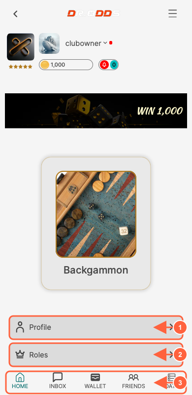

# راهنمای بازیکن

## ۱. پیدا کردن کلاب و ورود به آن

از صفحهٔ خانه یا لابی، کارت کلاب موردنظرتان را پیدا کنید. اگر چند کارت دارید، ردیف کلاب‌ها را به طرفین بکشید. دکمهٔ «جست‌وجوی کلاب» برای یافتن یک کلاب و دکمهٔ «ساخت کلاب» برای کسانی است که اجازهٔ ساخت دارند.

روی کارت کلاب بزنید تا لابی همان کلاب باز شود. کارت می‌تواند نام، تصویر، امتیاز و شناسهٔ عمومی کلاب را نشان دهد. پیش از ورود به بازی، بررسی کنید واقعاً کلاب موردنظر را باز کرده باشید؛ ارز کلاب و قوانین بازی بین کلاب‌ها ممکن است متفاوت باشد.

۱. بخش پروفایل کلاب.  
۲. «نقش‌ها» برای نمایش ترتیب نقش‌ها؛ این بخش معمولاً برای مدیریت قابل مشاهده است.  
۳. نوار پایین صفحه. در تصویر نمونه، خانه، صندوق پیام، کیف پول، دوستان و داده‌ها دیده می‌شوند. برچسب «کیف پول» در بعضی صفحه‌های کلاب به تب تبادل یا کیف پول همان کلاب می‌رود.

## ۲. نوار پایین و منوی همبرگری

نوار پایین میان‌برهای پرکاربرد دارد. چیدمان آن در لابی اصلی و لابی کلاب یکسان نیست:

- **خانه / لابی:** برگشت به فهرست کلاب‌ها یا خانهٔ کلاب.
- **صندوق:** گفت‌وگوها و پیام‌های قابل دسترس شما.
- **کیف پول / تبادل:** موجودی و سوابق، یا انتقال ارز همان کلاب؛ مقصد به زمینهٔ صفحه بستگی دارد.
- **شاپ:** مرور کالاهای عرضه‌شده برای حسابتان.
- **دوستان:** فهرست دوستان و درخواست‌ها، وقتی این گزینه در نوار شما باشد.
- **داده‌ها:** سابقه و آمار بازی‌ها.

گزینه‌های اصلی حساب در منوی سه‌خط بالا قرار دارند. راهنمای آن‌ها را در [شروع کار](start-here.md) ببینید.

## ۳. پروفایل و دوستان

با زدن آواتار یا بخش پروفایل، پروفایل بازیکن را باز کنید. صفحه ممکن است تصویر، نام نمایشی، نشان‌ها و آمار را نشان دهد. فقط اطلاعاتی را منتشر کنید که با مخاطبان همان تنظیم حریم خصوصی می‌خواهید در میان بگذارید.

از «دوستان» برای مرور ارتباط‌ها و درخواست‌ها استفاده کنید. ممکن است از بعضی صفحه‌ها بتوانید دوست را انتخاب کنید تا برای بازی دعوتش کنید. اگر فهرست خالی است، این لزوماً به معنی خرابی نیست؛ شاید هنوز درخواستی دریافت نکرده‌اید یا فیلتر فعالی دارید.

## ۴. صندوق پیام

در صندوق، گفت‌وگو یا اعلان موردنظر را باز کنید و متن را در کادر پایین بنویسید. پیش از فرستادن، نام طرف مقابل و زمینهٔ گفت‌وگو را دوباره بررسی کنید. پیام‌های یک کلاب فقط در صورت داشتن دسترسی لازم دیده می‌شوند. اگر صندوق یا یک گفت‌وگوی کلاب در منوی شما نیست، از مدیر کلاب بخواهید مجوز آن را بررسی کند.

## ۵. دعوت و عضویت

دعوت‌نامه ممکن است به شکل پیوند یا کد در اختیار شما قرار بگیرد. پیوند را فقط برای فردی بفرستید که واقعاً می‌خواهید به همان کلاب دعوت شود؛ با بازکردن پیوند ممکن است صفحهٔ عضویت همان کلاب نمایش داده شود. عضویت می‌تواند به تأیید مدیر نیاز داشته باشد. تا زمانی که وضعیت عضویت فعال نشده، بعضی بازی‌ها و بخش‌ها در دسترس نیستند.

اگر دعوت‌نامه منقضی یا رد شده است، از صاحب کلاب یا مدیری که دعوت را فرستاده بخواهید دعوت تازه‌ای بسازد. یک پیوند قدیمی را از فرد ناشناس نپذیرید.

## ۶. پیام‌های ورودی و اعلان‌های کلاب

اعلان پاپ‌آپی که هنگام ورود به کلاب می‌بینید ممکن است پیام صاحب کلاب باشد. متن را بخوانید و سپس به بازی یا لابی ادامه دهید. اعلان داخل کلاب را با اعلان سیستم‌عامل یکی نگیرید: تنظیم اعلان‌های دستگاه در منوی عمومی انجام می‌شود.

## ۷. وقتی گزینه‌ای را نمی‌بینید

نقش شما در هر کلاب جداگانه تعریف می‌شود؛ ممکن است در کلاب A بازیکن و در کلاب B مدیر باشید. همچنین صاحب کلاب می‌تواند منوهای مجاز هر نقش را تنظیم کند. صفحهٔ [نقش‌های کلاب](club-team.md) را ببینید یا از مدیر همان کلاب بپرسید. تغییر نقش یا دسترسی را خود بازیکن نمی‌تواند انجام دهد.

