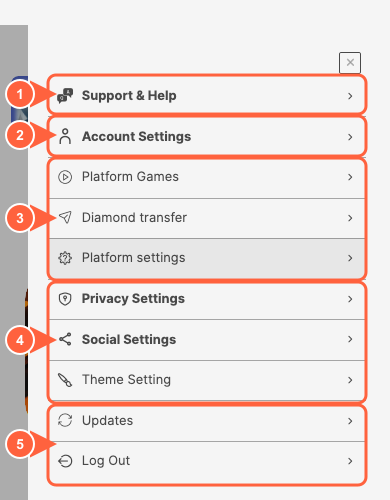

# شروع کار و منوی عمومی

## ورود و انتخاب زبان

1. صفحهٔ ورود Dr.odds را باز کنید و با روش ورودِ در دسترس حساب خود وارد شوید.
2. اگر برای ساخت یا تأیید حساب از شما کد خواسته شد، کد را فقط در صفحهٔ رسمی ورود خودتان وارد کنید؛ آن را برای شخص دیگری نفرستید.
3. در اولین ورود، لابی را می‌بینید. ممکن است کارت‌های کلاب، بازی‌های پیشنهادی یا امکاناتی که در همان لحظه فعال‌اند نمایش داده شوند.
4. برای تغییر زبان، منوی همبرگری را باز کنید و گزینهٔ «زبان / Language» را انتخاب کنید. فارسی و انگلیسی از زبان‌های برنامه‌اند. جهت صفحه نیز با زبان هماهنگ می‌شود.

برای بازکردن منوی اصلی، آیکون سه‌خط بالای صفحه را بزنید. برای برگشت از یک صفحه، دکمهٔ بازگشت همان صفحه را بزنید تا اگر تغییری ذخیره‌نشده باشد فرصت بررسی داشته باشید.

۱. «پشتیبانی و راهنما» برای پیدا کردن پاسخ‌ها و راه ارتباطی.  
۲. «تنظیمات حساب» برای کارهایی که به حساب و امنیت ورود مربوط‌اند.  
۳. میان‌برهای مدیریتی یا پلتفرمی؛ همهٔ حساب‌ها این گزینه‌ها را نمی‌بینند.  
۴. تنظیمات حریم خصوصی، اجتماعی و پوستهٔ نمایشی.  
۵. به‌روزرسانی‌ها و خروج از حساب.

## گزینه‌های منوی همبرگری

- **زبان:** انتخاب زبان نمایش.
- **صداها و لرزش:** میزان صدا و بازخورد صوتی/لرزش را با دستگاه خود تنظیم کنید.
- **اعلان‌ها:** انتخاب کنید چه اعلان‌هایی برایتان نمایش داده شوند؛ گزینه‌های موجود ممکن است بسته به نسخه متفاوت باشند.
- **حریم خصوصی:** نمایش اطلاعات پروفایل و گزینه‌های حریم خصوصی را بازبینی کنید.
- **تنظیم پوسته:** بین ظاهر روشن و تیره انتخاب کنید.
- **تنظیم پروفایل:** اطلاعات نمایشی پروفایل خود را مرور یا ویرایش کنید.
- **تنظیمات حساب:** بخش‌های امنیتی حساب، مانند تغییر گذرواژه یا حذف حساب، از این قسمت در دسترس‌اند. پیش از حذف، متن تأیید نهایی را با دقت بخوانید.
- **پشتیبانی و راهنما:** مرکز راهنما یا درخواست‌های پشتیبانی، در صورت فعال‌بودن برای حسابتان.
- **انصاف و امنیت بازی:** اطلاعات و شناسهٔ تصادفی عمومی بازی را ببینید.
- **خروج:** از حساب فعلی خارج می‌شوید. اگر از دستگاه مشترک استفاده می‌کنید، پس از پایان کار خارج شوید.

منوی اصلی گاهی زیرمنو دارد. برای مثال «تنظیمات حساب» و «پشتیبانی و راهنما» را باز کنید تا گزینه‌های داخلی آن‌ها را ببینید. اگر در منو «تنظیمات کلاب» می‌بینید، مطمئن شوید در کلاب مربوط هستید؛ این گزینه برای صاحب کلاب است.

## فرق بین لابی و صفحهٔ کلاب

- **لابی پلتفرم** جایی است که کلاب‌ها را پیدا می‌کنید، به کلاب می‌روید، کلاب می‌سازید (اگر مجاز باشد) و بعضی میان‌برهای حساب را می‌بینید.
- **لابی کلاب** صفحهٔ همان کلاب است؛ بازی‌ها، اعضا و منوهای مربوط به آن کلاب را در خود دارد.
- **منوی اصلی** تنظیمات عمومی حساب و میان‌برهای مدیریتی را نشان می‌دهد. منوهای مدیریتی کلاب ممکن است در صفحهٔ خود کلاب ظاهر شوند.

اگر چند حساب را روی یک دستگاه نگه می‌دارید، پیش از انجام هر کار حساس نام و نقش حساب فعال را بررسی کنید. بازی، دعوت، پیام یا انتقالی که از حساب فعال انجام شود به همان حساب نسبت داده می‌شود.

