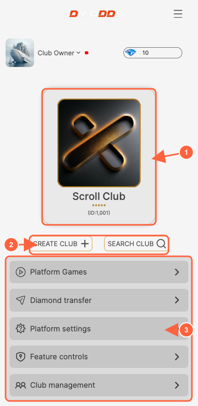

# راهنمای سوپرادمین

سوپرادمین به بخش‌های مدیریت کل پلتفرم دسترسی دارد. هر تغییری در این صفحات می‌تواند روی صاحبان کلاب، بازیکنان، کالاها یا هزینهٔ بازی اثر بگذارد؛ پیش از ذخیره، صفحه، هدف و مقادیر انتخاب‌شده را دوباره بخوانید.

## پیدا کردن بخش‌ها

از لابی، منوی سوپرادمین یا کارت‌های مدیریتی را باز کنید. در صفحهٔ «سوپرادمین» میان‌برهای اصلی و نوار مدیریتی را می‌بینید.

۱. کارت کلاب و انتخاب زمینهٔ کار.  
۲. جست‌وجو یا ساخت کلاب؛ فعال‌بودن ساخت کلاب به تنظیم پلتفرم بستگی دارد.  
۳. میان‌برهای پلتفرم: بازی‌ها، انتقال الماس، تنظیمات پلتفرم، کنترل قابلیت‌ها و مدیریت کلاب‌ها.

در نوار بخش سوپرادمین، این گزینه‌ها دیده می‌شوند: **سوپرادمین، بازی‌های پلتفرم، شاپ، بسته‌های الماس، الماس صاحبان کلاب، انتقال الماس**. میان‌برهای لابی می‌توانند **تنظیمات پلتفرم، کنترل قابلیت‌ها، مدیریت کلاب و مدیریت پلیرها** را هم نشان دهند.

## بازی‌های پلتفرم

در **بازی‌های پلتفرم** فهرست بازی‌های نصب‌شده و وضعیتشان را می‌بینید. بازی را باز کنید تا موارد قابل تنظیم را مرور کنید:

- **نام سیستمی:** شناسهٔ نمایشی داخلی بازی؛ برای راهنمای کاربری، نامی را که کاربران می‌بینند مبنا بگذارید.
- **نام بازی در کلاب‌ها:** نامی که در کارت یا فهرست کلاب دیده می‌شود.
- **تصویر کارت:** تصویر بازی را جایگزین، برش و ذخیره کنید.
- **دردسترس‌بودن بازی و گونه‌ها:** هر بازی یا گونه می‌تواند فعال یا غیرفعال باشد.
- **هزینهٔ اجرای بازی:** قیمت اجرای تک‌بازی، سیت‌اندگو یا تورنمنت ممکن است جداگانه و بر اساس کل مسابقه یا هر دست نمایش داده شود.

هزینهٔ خرید یا فروش خود بازی از صفحهٔ **شاپ** تنظیم می‌شود؛ هزینهٔ اجرای بازی را با قیمت خرید یکی نگیرید. پیش از تغییر وضعیت، پیام صفحه و اثر خاموش‌کردن بازی روی کلاب‌ها را بخوانید.

## شاپ پلتفرم

در **شاپ** محصول، دسته‌بندی و گروه کالا را باز کنید. بسته به نوع محصول می‌توانید نام و توضیح، قیمت الماس، تصویر، موجودی، وضعیت عرضه یا مدت عرضه را ویرایش کنید.

- اگر موجودی محدود است، مقدار باقی‌مانده را با دقت تغییر دهید؛ صفر می‌تواند به معنی تمام‌شدن کالا باشد.
- قبل از فعال‌کردن عرضه، قیمت و توضیحی را که بازیکن می‌بیند کنترل کنید.
- کالاهایی که دسترسی یا اشتراک می‌فروشند فقط برای گروه و خریدارهایی عرضه می‌شوند که توضیح همان محصول مشخص کرده است.
- پس از ذخیره، محصول را در نمای شاپ مرور کنید تا نام، قیمت و دسته درست باشد.

## بسته‌های الماس

صفحهٔ **بسته‌های الماس** برای بسته‌هایی است که صاحبان کلاب می‌توانند تهیه کنند. تعداد الماس و قیمت دلاری را وارد کنید. فقط بستهٔ فعال به صاحب کلاب پیشنهاد می‌شود. پیش از فعال‌سازی، واحد پول، تعداد و قیمت را جداگانه بازبینی کنید.

## الماس صاحبان کلاب

این صفحه موجودی الماس صاحبان کلاب و درخواست‌های خریدشان را نشان می‌دهد. درخواست پرداخت را فقط بعد از تطبیق شناسهٔ پرداخت و تأیید رسید/مرجع طبق روند کاری خودتان نهایی کنید. تا زمانی که پرداخت قابل تأیید نیست، درخواست را تأیید نکنید. برای راهنمایی عمومی یا تصویرسازی، از اطلاعات واقعی حساب‌ها و درخواست‌ها اسکرین‌شات عمومی نسازید.

## انتقال الماس

در بخش **انتقال الماس**، حساب را با شناسه یا نشانی مشخصی که صفحه می‌پذیرد پیدا کنید، سپس افزایش یا کاهش موجودی و مبلغ را انتخاب کنید. قبل از ثبت:

1. مطمئن شوید حساب مقصد همان حساب موردنظر است.
2. نوع عملیات را بخوانید: افزودن یا کسر موجودی.
3. مبلغ را بازبینی کنید؛ کار حسابی جداگانه‌ای است و موجودی الماس خود سوپرادمین را تغییر نمی‌دهد.
4. بعد از ذخیره، نتیجه را در گزارش مالی فیلترشده بررسی کنید.

گزارش الماس را با بازهٔ تاریخ، حساب، دسته و نوع تراکنش فیلتر کنید. دسته‌ها ممکن است شامل تنظیم مدیر، اجرای بازی و برگشت آن، مجوز بازی، خرید الماس، خرید شاپ و انتقال تیم کلاب باشند. گزارش را پیش از خروجی‌گرفتن از نظر بازه و هدف بازبینی کنید.

## بنرهای صفحهٔ خانه

اگر گزینهٔ **بنرها / Banners** در نسخهٔ شما فعال است، از آن برای مرتب‌کردن بنرهای چرخشی پایین صفحهٔ خانه استفاده کنید. در این صفحه تصویر، ترتیب نمایش، دیده‌شدن و مقصد کلیک هر بنر را تنظیم می‌کنید. برای هر تصویر، توضیح جایگزین انگلیسی و فارسی بنویسید تا در هر دو زبان به‌درستی معرفی شود.

1. برای اضافه‌کردن مورد، **Add banner** را بزنید؛ برای حذف مورد موجود، همان ردیف را انتخاب و **Remove banner** را بزنید.
2. تصویر را انتخاب و در قاب برش تنظیم کنید. اندازهٔ قاب **۱۴۷۲ × ۶۸۰** است. فایل منبع JPG، PNG یا WebP می‌تواند حداکثر ۱۲ مگابایت باشد؛ تصویر ذخیره‌شده باید پس از فشرده‌سازی کمتر از ۶۰۰ کیلوبایت باشد.
3. مقصد کلیک را مشخص کنید: بدون لینک، بازکردن منو، بازکردن کلاب، پیوستن به کلاب، بازکردن تورنمنت یا رفتن به صفحهٔ ثبت‌نام تورنمنت. اگر مقصد به شناسهٔ کلاب یا تورنمنت نیاز دارد، شناسهٔ درست را وارد کنید.
4. ترتیب و وضعیت نمایش همهٔ بنرها را بازبینی و سپس **Save** را بزنید؛ تغییرهای صفحه با هم ذخیره می‌شوند.

کلیک روی بنرِ تورنمنت به‌تنهایی بازیکن را عضو یا ثبت‌نام نمی‌کند. بازیکن همچنان باید عضویت لازم، ظرفیت، رمز و مبلغ ورودی را در صفحهٔ مربوط بررسی کند و خودش مراحل عادی پیوستن یا ثبت‌نام را انجام دهد. پس از ذخیره، خانه را باز کنید و مقصد بنر را با یک کلیک بررسی کنید.

## تنظیمات پلتفرم و کنترل قابلیت‌ها

**Platform settings** برای نمایش یا پنهان‌کردن ساخت کلاب و گزینه‌های منو است. **Feature controls** برای روشن‌کردن یا متوقف‌کردن قابلیت‌هایی مثل ثبت‌نام و پخش زنده و تعریف استثنا برای کلاب یا حساب است. تغییر این بخش‌ها می‌تواند روی کاربران دیگر اثر بگذارد؛ پیش از اعمال تغییر، کلاب یا حساب هدف و دامنهٔ اثر را دوباره بررسی کنید. راهنمای مرحله‌به‌مرحله در [تنظیمات پلتفرم](platform-settings.md) آمده است.

## مدیریت کلاب‌ها

کلاب را با نام، شناسه یا نشانی پیدا کنید و بر اساس وضعیت فیلتر کنید. در صفحهٔ هر کلاب تب‌های **Players، Live games و Finance** را می‌بینید:

- **Players:** اعضا را پیدا کنید و وضعیت فعال، دعوت‌شده یا تعلیق‌شده را مرور کنید.
- **Live games:** بازی‌های در حال اجرا را بر اساس بازی فیلتر کنید.
- **Finance:** بازهٔ تاریخ، نوع تراکنش، موضوع گزارش و جهت را مشخص کنید؛ جمع و تعداد تراکنش‌ها را ببینید و در صورت نیاز نتیجهٔ همین فیلترها را در Excel بگیرید.

## مدیریت بازیکنان

در **Player management** می‌توانید فهرست بازیکنان پلتفرم را با نام، نام کاربری، ایمیل یا شناسهٔ بازیکن جست‌وجو کنید. هر ردیف تعداد کلاب‌های مرتبط را نیز نشان می‌دهد. با بازکردن حساب، جزئیات حساب، عضویت‌های کلاب، موجودی‌های تأییدشدهٔ ارز کلاب و فعالیت واقعی بازی را مرور کنید.

این اطلاعات برای رسیدگی به درخواست همان بازیکن است. پیش از هر اقدام، شناسهٔ حساب و کلاب موردنظر را تطبیق دهید و از نام، ایمیل، شناسه یا موجودی واقعی در تصویر عمومی، پیام عمومی یا راهنمای قابل انتشار استفاده نکنید.
